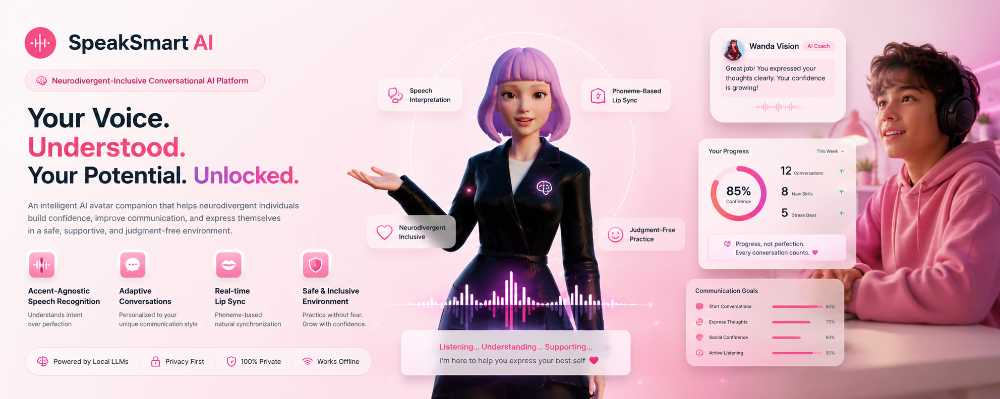
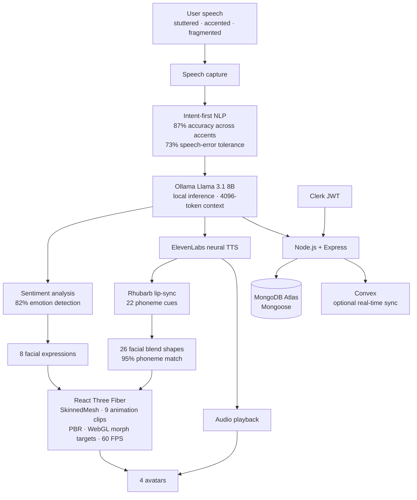
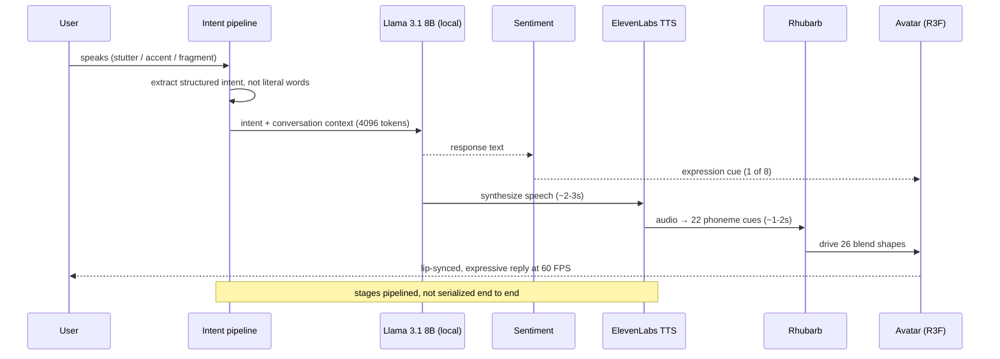

# 🧠 SpeakSmart AI — Accessible Speech-Intent Platform with Lip-Synced Avatars

<div align="center">



**Most conversational AI is built for "perfect" speech. This one is built for everyone else.**
*An intent-first pipeline that turns stuttered, accented or fragmented speech into structured intent — answered by a real-time 3D avatar with phoneme-accurate lip sync.*

[](https://reactjs.org/)
[](https://threejs.org/)
[](https://ollama.ai/)
[](https://www.mongodb.com/)
[](https://elevenlabs.io/)
[](https://clerk.com/)

**🏆 Top 3 Hackathon Winner**

</div>

---

## Highlights

- Built an **intent-first pipeline** that converts imperfect speech into structured intent data, reaching **87% intent recognition accuracy** across accents and holding up under **73% speech-error tolerance** in severe stuttering scenarios — because standard speech systems simply reject that input.
- Implemented real-time **lip synchronization** mapping audio to **22 phoneme cues** via **Rhubarb**, animating **26 facial blend shapes** at **95% phoneme match precision**.
- Added **8 real-time facial expressions** driven by sentiment analysis on top of neural **ElevenLabs** text-to-speech, reaching **82% emotion-detection accuracy**, so responses do not land flat.
- Shipped **4 distinct avatars** with their own personalities, rendered through React Three Fiber `SkinnedMesh` models across **9 animation clips** with PBR materials and WebGL morph-target blending.
- Ran **Ollama Llama 3.1 8B locally** for intent processing — keeping the core loop private and free — while sustaining **60 FPS** rendering on-device with a **4096-token** conversation context window.
- Pipelined **~4.6 s** LLM inference, **2–3 s** TTS generation and **1–2 s** lip-sync processing into one perceived turn, instead of leaving the user waiting on a single slow stage.
- Paired **MongoDB Atlas** (Mongoose) for durable storage with **Convex** for optional real-time sync, behind **Clerk JWT** authentication.

---

## Architecture



## One conversational turn



---

## Measured results

| Metric | Value |
|---|---|
| Intent recognition across accents | **87%** |
| Speech-error tolerance (severe stuttering) | **73%** |
| Phoneme match precision | **95%** |
| Emotion-detection accuracy | **82%** |
| Rendering | **60 FPS** on-device |
| Blend shapes / phoneme cues | **26** / **22** |
| Avatars / animation clips | **4** / **9** |

## Latency budget

| Stage | Time |
|---|---|
| LLM inference (local Llama 3.1 8B) | ~4.6 s |
| ElevenLabs TTS | 2–3 s |
| Rhubarb lip-sync | 1–2 s |

## Tech stack

**Frontend** React 18.2 · Vite · Three.js · React Three Fiber · WebGL morph targets · Tailwind CSS · Leva
**Backend** Node.js · Express · MongoDB Atlas · Mongoose · Convex
**AI & speech** Ollama (Llama 3.1 8B, local) · ElevenLabs TTS · Rhubarb lip-sync · FFmpeg · sentiment analysis
**Auth** Clerk (JWT)

## Quick start

```bash
git clone https://github.com/Brijesh03032001/EmotiSphere.git
cd EmotiSphere
```

```bash
ollama pull llama3.1:8b && ollama serve
```

```bash
cd SparkAI_Backend && npm install && npm run dev     # MONGODB_URI, ELEVENLABS_API_KEY, CLERK keys
```

```bash
cd SparkAI_Frontend && npm install && npm run dev
```

---

**Built by [Brijesh Kumar](https://github.com/Brijesh03032001)** · [Portfolio](https://brijeshbuilds.com) · [LinkedIn](https://linkedin.com/in/brijeshkumar03)
